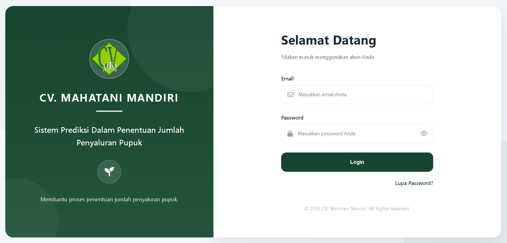
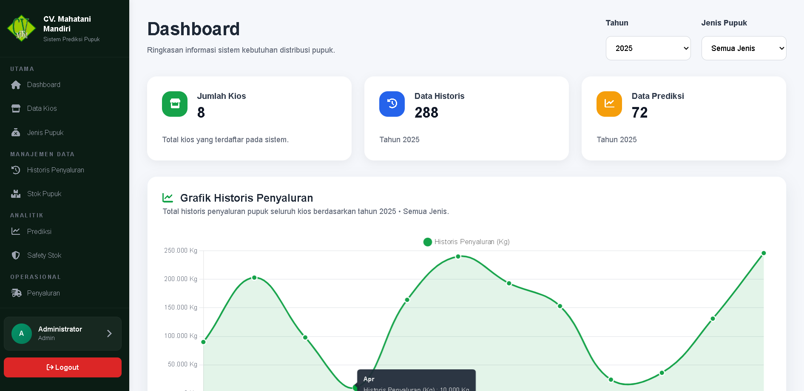
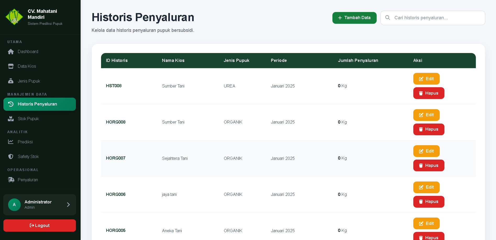
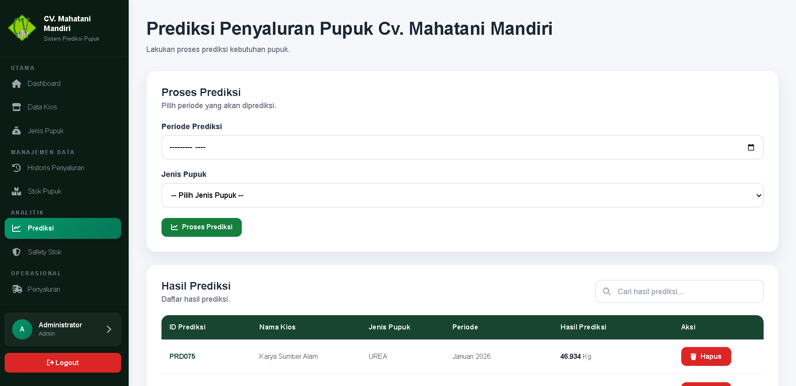
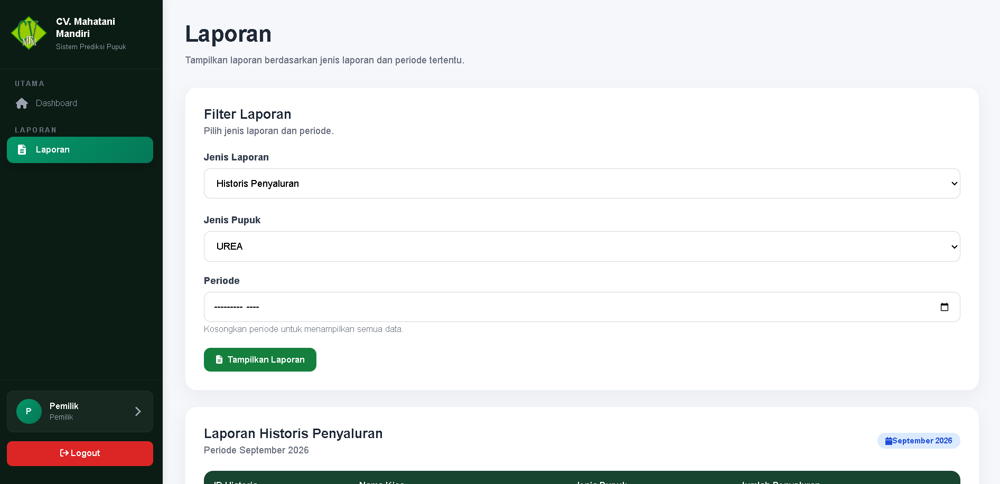

# Prediksi Pupuk — CV. Mahatani Mandiri

Sistem informasi berbasis web yang dikembangkan untuk membantu pengelolaan data pupuk pada **CV. Mahatani Mandiri**. Sistem mencakup pengelolaan data kios, stok pupuk, penyaluran, pengajuan, laporan, serta fitur prediksi menggunakan **metode Theta**.

## ✨ Fitur

* 🔐 Login dan autentikasi pengguna
* 📊 Dashboard sistem
* 🏪 Pengelolaan data kios
* 🌱 Pengelolaan jenis pupuk
* 📦 Pengelolaan stok pupuk
* 🚚 Pengelolaan data penyaluran
* 📋 Riwayat penyaluran
* 📈 Prediksi jumlah penyaluran menggunakan metode Theta
* ⚠️ Pengelolaan safety stock
* 📝 Pengajuan penyaluran
* 📄 Pembuatan laporan
* 👤 Pengelolaan profil pengguna

## 🛠️ Teknologi

* **Laravel**
* **PHP**
* **MySQL**
* **Blade**
* **JavaScript**
* **Vite**
* **CSS**

## 📸 Screenshots

### Login



### Dashboard



### Penyaluran



### Prediksi



### Laporan



## ⚙️ Instalasi

### 1. Clone repository

```bash
git clone https://github.com/amrullah-dev/prediksi-pupuk.git
cd prediksi-pupuk
```

### 2. Install dependency PHP

```bash
composer install
```

### 3. Install dependency JavaScript

```bash
npm install
```

### 4. Buat file environment

Salin `.env.example` menjadi `.env`.

```bash
cp .env.example .env
```

Untuk Windows, file `.env` juga dapat dibuat dengan menyalin `.env.example` secara manual.

### 5. Generate application key

```bash
php artisan key:generate
```

### 6. Konfigurasi database

Buat database MySQL kemudian sesuaikan konfigurasi database pada file `.env`.

### 7. Jalankan migration

```bash
php artisan migrate
```

### 8. Jalankan aplikasi

```bash
php artisan serve
```

Kemudian buka aplikasi melalui alamat yang ditampilkan oleh Laravel.

Untuk menjalankan Vite pada mode development:

```bash
npm run dev
```

## 📂 Struktur Project

```text
prediksi-pupuk/
├── app/
├── bootstrap/
├── config/
├── database/
├── public/
├── resources/
├── routes/
├── screenshots/
├── storage/
├── tests/
├── .env.example
├── composer.json
├── package.json
└── README.md
```

## 🎯 Tujuan Project

Project ini dikembangkan sebagai sistem informasi untuk membantu proses pengelolaan data pupuk dan mendukung penentuan jumlah penyaluran berdasarkan hasil prediksi.

## 👨‍💻 Developer

**Muhammad Amrullah**

Project ini dikembangkan sebagai bagian dari pengembangan sistem informasi berbasis web.
